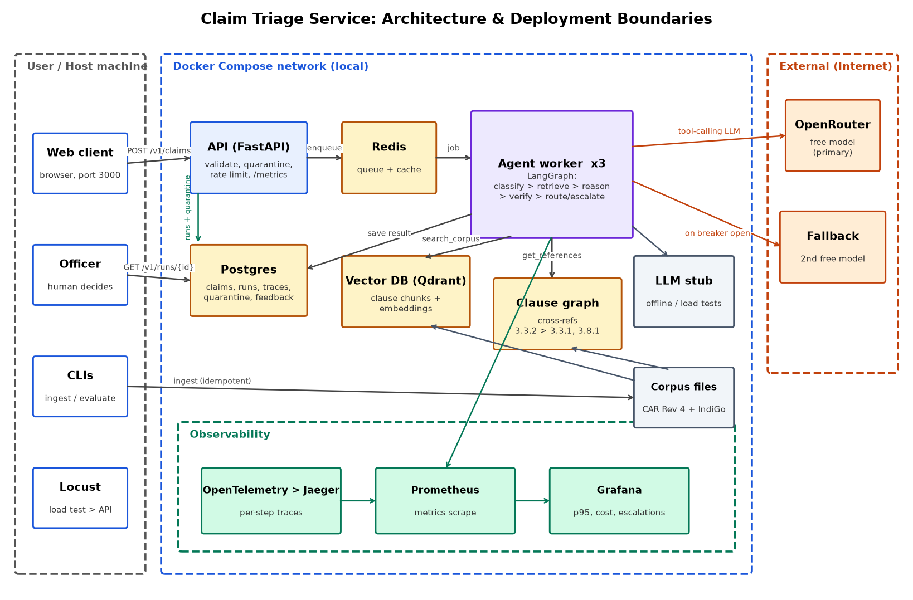

# Air Passenger Compensation Claim Triage Service

Multi-agent service that triages Indian domestic air-passenger disruption claims against
**DGCA CAR Section 3, Series M, Part IV (Rev 4, effective 15 Feb 2023)** and one airline's
Conditions of Carriage. It recommends `pay_as_computed`, `request_further_evidence` or `decline`
with clause-level citations, or escalates to a human. **It never authorises payment.**

Course: UE24AM342AA5 ML System Design & AgentOps, Mini Project 04 (PES University).



## Quick start

Local dev uses [uv](https://docs.astral.sh/uv/) (one workspace, one `uv.lock`):

```bash
uv sync            # creates .venv with every service + dev tools
uv run pytest      # tests
uv add --package triage-worker <pkg>   # add a dependency to one service
```

Build the clause corpus (requires Poppler's `pdftotext`, e.g. `sudo apt install poppler-utils`):

```bash
make corpus        # download/verify the manifest-pinned sources
make ingest        # write corpus/processed/{chunks.jsonl,refs.json,definitions.json}
```

See [the graph skeleton guide](docs/agent-graph.md) for the offline demo and budget behavior.

See [the ingestion guide](docs/ingestion.md) for artifact formats, reference resolution, and tests.

For production-like troubleshooting, see the [operational runbooks](docs/runbooks.md) and
[incident log](docs/incident-log.md). The runbooks include Chroma repair/retrieval checks, Grafana dashboards, and correlated
API/worker traces. The separate verifier remains tracked in
[issue #6](https://github.com/Adarsh-031/claim-triage-service/issues/6).

Run the stack:

```bash
cp .env.example .env
docker compose up --build -d
docker compose ps
curl -i localhost:8000/readyz
```

The first startup downloads the DGCA CAR PDF and checks its SHA-256 against the corpus manifest. The one-shot
`ingest` service builds and indexes 246 chunks, then verifies known retrieval before
the worker starts. Its first run downloads MiniLM weights into a persistent cache. In `docker compose ps`, long-running services should be healthy
and `ingest` should show `Exited (0)`. The readiness request should return HTTP 200.

## Services and ports

| Service | Host port → container port | Access |
|---|---:|---|
| Web client (nginx) | 3000 → 80 | http://localhost:3000 |
| API | 8000 → 8000 | http://localhost:8000/docs |
| LLM stub | 8001 → 8001 | http://localhost:8001 (health: `/healthz`) |
| Jaeger UI | 16686 → 16686 | http://localhost:16686; OTLP 4317 is internal |
| Prometheus | 9090 → 9090 | http://localhost:9090 |
| Grafana | 3001 → 3000 | http://localhost:3001 (credentials come from `.env`) |
| PostgreSQL | internal only: 5432 | Compose network |
| Redis | internal only: 6379 | Compose network |
| Chroma | internal only: 8000 | Compose network |
| Worker | no port | Queue consumer; health check verifies Redis and PostgreSQL |
| Ingest | no port | One-shot corpus fetch/ingest job |

Submit a claim:

```bash
curl -s -X POST localhost:8000/v1/claims -H 'content-type: application/json' \
  -d @eval/scenarios/s01_demo_cancellation_alternate_taken.json | jq
curl -s localhost:8000/v1/runs/<run_id> | jq
```

Verify indexing: `docker compose run --rm --no-deps ingest python cli/index_corpus.py --verify`.
Verify correlated traces: `uv run python scripts/smoke_observability.py`.
Grafana provisions **Triage — Services** and **Triage — Agents** in the **Claim Triage** folder.

Scale workers: `docker compose up --scale worker=3`; Prometheus discovers each replica.

PostgreSQL's initialization script runs only when its data volume is empty. After changing the database schema for this
demo, recreate the local database volume with `docker compose down -v` before starting the stack again. This deletes
local PostgreSQL data; do not use it on a volume containing data you need to keep. The `.env.example` values are for local development;
replace them for any shared or deployed environment.

## Layout

```
services/api       FastAPI: contract validation, quarantine, run API, health, metrics
services/worker    Queue consumer + LangGraph agent, tools, LLM provider interface
services/web       Static officer console (A8: appearance not assessed)
libs/common        Shared data contracts (Pydantic) and settings
cli                ingest.py (idempotent corpus ingestion), evaluate.py (eval set)
corpus/            Source documents + manifest (versions, URLs, hashes)
eval/scenarios     >=20 fixed scenarios with expected outcome and passage
deploy/            Prometheus, Grafana provisioning
docs/              Requirements, design, report material, runbooks, incident log
```

## Status

| Priority | Item | State |
|---|---|---|
| P0 | Compose, API, queue, worker, run polling | scaffolded |
| P0 | Clause chunks + reference/definition exports | implemented with idempotent MiniLM/Chroma indexing and retrieval checks |
| P0 | Bounded LangGraph skeleton, cited demo case 4.1 | Chroma vector/BM25 retrieval and exact clause lookup implemented; grounding verification/reasoning pending |
| P1 | Verifier, escalation, observability, eval, circuit breaker, web client | partial |
| P2 | Dashboards, Locust/scaling study, caching study, prompt A/B | service/agent dashboards provisioned; scaling/cache/prompt studies pending |

## Configuration

All model IDs, endpoints and keys come from `.env` (never committed). `LLM_PROVIDER=stub`
runs fully offline and is used for development, evaluation and load tests.
